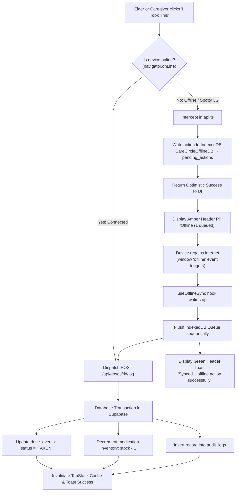
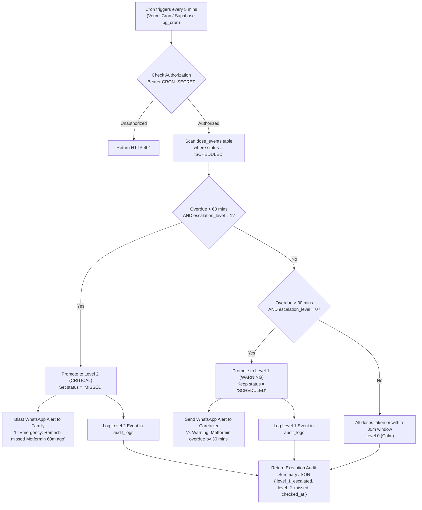
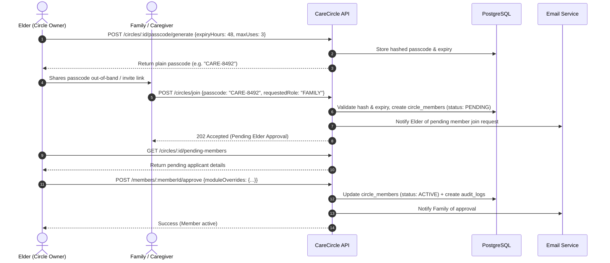
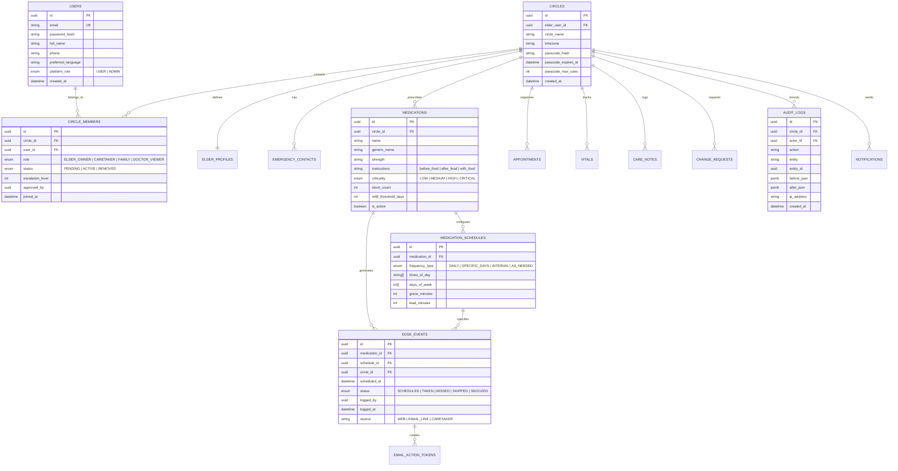

# CareCircle: System Design & Architecture Specification

## 1. System Design Overview

CareCircle is an elder-centric healthcare management ecosystem designed to balance elderly autonomy, caregiver collaboration, and clinical reliability. The architecture follows a **Modular Monolith** pattern optimized for high velocity in a hackathon setting while maintaining clear domain boundaries that allow microservice extraction as traffic scales.

### 1.1 Architecture Highlights
- **Client Tier**: Next.js App Router (PWA) with dual-mode UX:
  - *Elder Mode*: Simplified, high-contrast, large touch-target interface with voice prompts & Web Speech TTS.
  - *Caregiver & Family Mode*: Comprehensive clinical/routine management dashboard.
- **Application & API Gateway Tier**: NestJS modular application enforcing strict layered security (`AuthGuard` -> `CircleMemberGuard` -> `PermissionPolicyGuard`).
- **Data & Ingestion Tier**: PostgreSQL with Prisma ORM, multi-tenant circle isolation via compound indexes.
- **Async Execution Tier**: Redis + BullMQ scheduler engine handling delayed dose dispatch, idempotency, retry mechanisms, and missed-dose escalation ladders.
- **External Integration Tier**:
  - Resend / Nodemailer for transactional & signed one-tap dose response emails.
  - S3 / Cloud Storage for encrypted prescription/report artifacts.
  - Drug interaction dataset/advisory engine.

---

## 2. High-Level Architecture & System Design Flowcharts

### 2.1 Complete End-to-End System Design Flowchart

```mermaid
flowchart TD
    %% SUBGRAPH 1: ACTORS & ENTRY POINTS
    subgraph S1["1. Actors & Devices"]
        U1["👴 Elder / Patient\n(Mobile PWA / Large Text)"]
        U2["🩺 Caretaker / Nurse\n(Tablet / Shift Ops)"]
        U3["👨‍👩‍👧 Family Member\n(Smartphone / Peace of Mind)"]
        U4["👨‍⚕️ Doctor / Clinician\n(Desktop / Hospital Rounds)"]
        U5["🚑 First Responder / Paramedic\n(Mobile Camera QR Scan)"]
        U6["💬 WhatsApp User\n(Elder / Family / SMS)"]
    end

    %% SUBGRAPH 2: CLIENT PWA LAYER
    subgraph S2["2. Client Layer: PWA & Offline Engine"]
        SHELL["CareCircle AppShell\n(Role-Adaptive Interface)"]
        IDB[("IndexedDB Queue\nCareCircleOfflineDB")]
        SYNC["Background Replay Hook\n(useOfflineSync)"]
        TTS["Web Speech API\n(Schedule Audio Reader)"]
        CAM["HTML5 Camera Scanner\n(html5-qrcode)"]
        VQR["Dynamic QR Code\n(react-qr-code)"]
    end

    %% SUBGRAPH 3: EDGE GATEWAY & SECURITY
    subgraph S3["3. Edge Gateway & Security Layer"]
        CF["Cloudflare Edge CDN\n(WAF, DDoS Protection, SSL)"]
        VERCEL["Vercel Serverless Gateway\n(/api/* Route Handlers)"]
        RBAC["Consent & RBAC Guard\n(can(member, action))"]
        CRON_AUTH["Cron Token Validator\n(Bearer CRON_SECRET)"]
    end

    %% SUBGRAPH 4: CORE APPLICATION ENGINES
    subgraph S4["4. Core Application Engines"]
        ENG_AUTH["Passcode & Session Engine\n(CARE-XXXX, 48h TTL)"]
        ENG_DOSE["Dose & Adherence Engine\n(Daily Matrix, Streak Aggregator)"]
        ENG_ESCALATE["5-Min Escalation Watchdog\n(L0: Calm → L1: 30m → L2: 60m)"]
        ENG_VITALS["Clinical Vitals Guard\n(Anomaly Flag: BP > 140, Sugar > 180)"]
        ENG_WA["WhatsApp Inbound Bot\n(Webhook NLP: 1, STATUS, SOS)"]
        ENG_FHIR["HL7 FHIR R4 Export Engine\n(LOINC 85354-9, RxNorm Bundle)"]
    end

    %% SUBGRAPH 5: DATABASE LAYER (SUPABASE POSTGRES)
    subgraph S5["5. Database & Persistence Layer (Supabase PostgreSQL)"]
        T_USERS[("users\n(id, email, full_name, lang)")]
        T_CIRCLES[("circles & circle_members\n(roles, permissions, passcode)")]
        T_MEDS[("medications\n(dosage, stock_count, criticality)")]
        T_DOSES[("dose_events\n(scheduled_at, status, logged_by)")]
        T_VITALS[("vitals\n(type, value, secondary, alert)")]
        T_NOTES[("care_notes & change_requests\n(shift handovers, status)")]
        T_AUDIT[("audit_logs\n(immutable event stream)")]
    end

    %% SUBGRAPH 6: EXTERNAL THIRD-PARTY INTEGRATIONS
    subgraph S6["6. External Integrations"]
        WA_API["Meta WhatsApp Cloud API\n(Two-way Outbound Messaging)"]
        EMR["Hospital EMR Systems\n(Epic, Cerner, ABDM via FHIR JSON)"]
    end

    %% CONNECTIONS & FLOW
    U1 & U2 & U3 & U4 --> SHELL
    U1 -.-> TTS
    U5 -->|Camera Scan /e/:token| CF
    U6 <-->|Two-way Chat| WA_API

    SHELL <--> SYNC
    SYNC <--> IDB
    SHELL --> CAM & VQR

    SHELL -->|HTTPS / API Requests| CF
    CF --> VERCEL
    WA_API -->|Inbound Webhook /api/whatsapp/webhook| VERCEL

    VERCEL --> RBAC
    VERCEL --> CRON_AUTH

    RBAC --> ENG_AUTH & ENG_DOSE & ENG_VITALS & ENG_FHIR
    CRON_AUTH --> ENG_ESCALATE
    VERCEL --> ENG_WA

    ENG_AUTH --> T_USERS & T_CIRCLES
    ENG_DOSE --> T_MEDS & T_DOSES
    ENG_ESCALATE --> T_DOSES & T_AUDIT
    ENG_VITALS --> T_VITALS
    ENG_WA --> T_DOSES & T_AUDIT
    ENG_FHIR --> EMR

    ENG_ESCALATE -.->|Overdue Alert L1 / L2| WA_API
    ENG_WA -.->|Confirmation Reply| WA_API

    ENG_DOSE & ENG_VITALS & ENG_AUTH --> T_AUDIT
```



### 2.2 Offline-First Synchronization & Background Replay Flowchart



### 2.3 Automated 5-Minute Escalation Watchdog Flowchart



---

## 3. Core Workflow Sequence Diagrams

### 3.1 Passcode-Based Onboarding & Consent Center Flow



### 3.2 Dose Generation, Reminder, and Escalation Ladder

```mermaid
sequenceDiagram
    autonumber
    participant Cron as BullMQ Scheduler
    participant DB as PostgreSQL
    participant Worker as Reminder / Escalation Worker
    participant Email as Email Gateway
    actor Elder as Elder
    actor Caregiver as Caregiver (Level 1)
    actor Family as Family (Level 2)

    Note over Cron,DB: Nightly / Schedule Update
    Cron->>DB: Generate dose_events for next 7 days in Circle Timezone (UTC stored)
    
    Note over Worker,Elder: At scheduled_at - lead_minutes (e.g., -15 min)
    Worker->>Email: Send Upcoming Dose Email with One-Tap Signed Token
    Email-->>Elder: Receives Email

    alt Elder marks dose taken
        Elder->>Email: Clicks "Mark as Taken" (GET /e/:token)
        Email->>DB: Update dose_events (status: TAKEN, logged_at: now), decrement stock
    else Elder misses dose within grace period (scheduled_at + grace_minutes)
        Worker->>DB: Check dose_events; status remains SCHEDULED past grace period
        Worker->>DB: Update dose_events (status: MISSED)
        
        Note over Worker,Caregiver: Escalation Level 1 (T + 15 min)
        Worker->>Email: Send alert to Caretaker ("Dose missed by Elder")
        Email-->>Caregiver: Alert notification

        opt Still unacknowledged at Escalation Level 2 (T + 45 min)
            Worker->>Email: Send urgent alert to Family ("Dose unconfirmed")
            Email-->>Family: Critical escalation alert
        end
    end
```

---

## 4. Database Schema & Entity Relationship Diagram (ERD)



---

## 5. Security & Access Control Architecture

### 5.1 Guard Chain Architecture
Every HTTP request to an authenticated endpoint runs through a three-stage pipeline:
1. **`AuthGuard`**: Decodes and verifies the Bearer JWT access token or checks the session cookie. Injects `req.user`.
2. **`CircleMemberGuard`**: Extracts `:circleId` from path or query params. Validates that `req.user.id` is an `ACTIVE` member of that circle. Injects `req.circleMembership`.
3. **`PermissionPolicyGuard`**: Inspects user's role + `member_permissions` granular overrides. If the action is a mutation by a `FAMILY` member on restricted entities (like `medications`), redirects to create a `change_request` instead of directly applying the mutation.

### 5.2 Tokenized Email Action Security
- Tokens are 32-byte cryptographically secure random values stored **hashed** (`sha256`) in `email_action_tokens`.
- Validity window: **2 hours**.
- Single-use: atomicity enforced with PostgreSQL transaction (`UPDATE ... WHERE used_at IS NULL RETURNING ...`).
- Scoped strictly to one `dose_event_id` and specific action (`TAKEN` / `SNOOZE` / `SKIP`).

---

## 6. Project Directory Layout (Monorepo)

```
c:\Projects\CareCircle\
├── apps/
│   ├── web/                         # Next.js 14+ PWA Client
│   │   ├── src/
│   │   │   ├── app/                 # App Router pages
│   │   │   │   ├── (auth)/          # login, register, verify, forgot
│   │   │   │   ├── (dashboard)/     # today, meds, appointments, vitals, circle
│   │   │   │   ├── e/[token]/       # Signed one-tap email action landing page
│   │   │   │   └── emergency/[id]/  # Public SOS Emergency Card page
│   │   │   ├── components/          # Elder-friendly UI components (shadcn/ui)
│   │   │   ├── hooks/               # TTS, Speech-to-text, data fetchers
│   │   │   └── lib/                 # API client, i18n dictionaries
│   │   ├── public/                  # PWA manifest, service workers, icons
│   │   └── package.json
│   │
│   └── api/                         # NestJS Backend Application
│       ├── src/
│       │   ├── auth/                # Auth, JWT, rotating refresh, argon2
│       │   ├── circles/             # Circle creation, passcode, members, consent
│       │   ├── medications/         # Med CRUD, schedule builder, drug interaction
│       │   ├── doses/               # Dose event querying, logging, email tokens
│       │   ├── appointments/        # Calendar, doctors, reminders, documents
│       │   ├── health/              # Vitals, care notes, routine tasks
│       │   ├── reports/             # Adherence computation, PDF generation
│       │   ├── jobs/                # BullMQ scheduler & workers (escalations)
│       │   ├── mail/                # Email templates & sender service
│       │   └── common/              # Guards, decorators, audit interceptor
│       ├── prisma/                  # schema.prisma, migrations, seeds
│       └── package.json
│
├── packages/
│   ├── shared/                      # Shared DTOs, Zod schemas, TypeScript types
│   │   ├── src/
│   │   │   ├── auth.ts
│   │   │   ├── circles.ts
│   │   │   ├── medications.ts
│   │   │   └── permissions.ts
│   │   └── package.json
│   └── tsconfig/                    # Shared TypeScript configs
│
├── docker-compose.yml               # PostgreSQL & Redis development services
├── pnpm-workspace.yaml              # Monorepo workspace configuration
├── package.json                     # Monorepo root scripts
└── README.md
```
