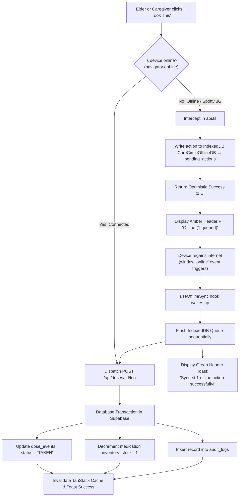
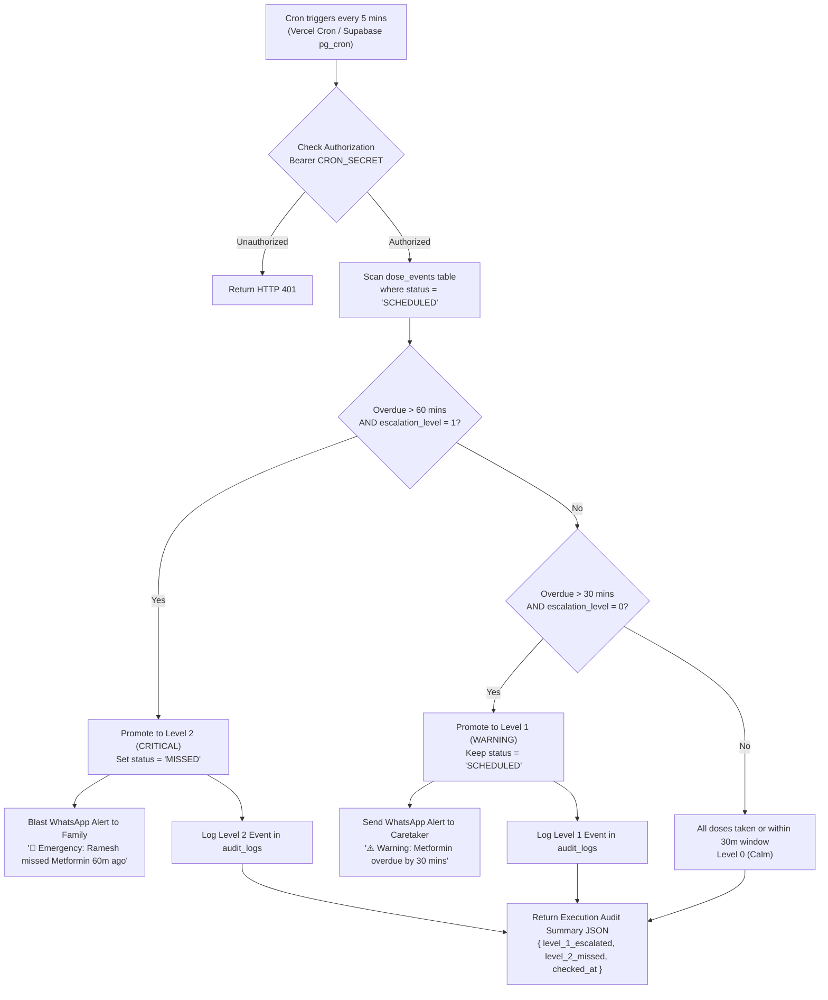
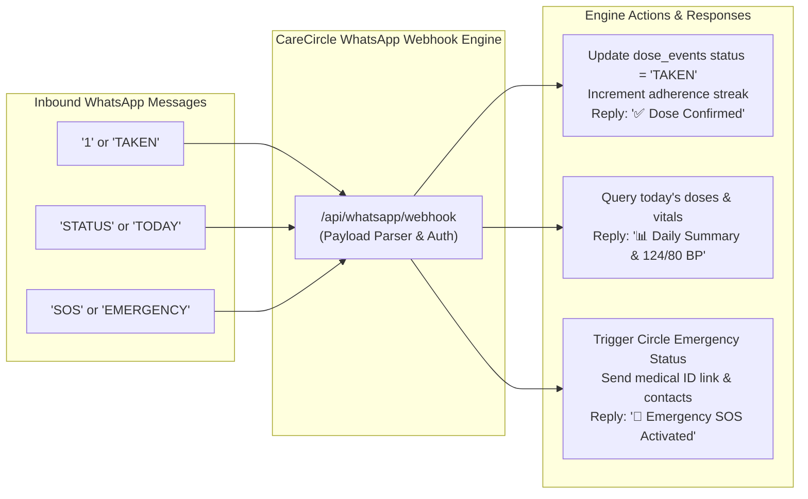

# CareCircle: System Design & Architecture Flowcharts

This document compiles the visual Mermaid flowcharts defining the CareCircle elder-centric collaborative healthcare platform.

---

## 1. Complete End-to-End System Design Flowchart

Traces the entire lifecycle from all 6 user roles down to the database and external integrations:

```mermaid
flowchart TD
    %% SUBGRAPH 1: ACTORS & ENTRY POINTS
    subgraph S1["1. Actors & Devices"]
        U1["👴 Elder / Patient\n(Mobile PWA / Large Text)"]
        U2["🩺 Caretaker / Nurse\n(Tablet / Shift Ops)"]
        U3["👨‍👩‍👧 Family Member\n(Smartphone / Peace of Mind)"]
        U4["👨‍⚕️ Doctor / Clinician\n(Desktop / Hospital Rounds)"]
        U5["🚑 First Responder / Paramedic\n(Mobile Camera QR Scan)"]
        U6["💬 WhatsApp User\n(Elder / Family / SMS)"]
    end

    %% SUBGRAPH 2: CLIENT PWA LAYER
    subgraph S2["2. Client Layer: PWA & Offline Engine"]
        SHELL["CareCircle AppShell\n(Role-Adaptive Interface)"]
        IDB[("IndexedDB Queue\nCareCircleOfflineDB")]
        SYNC["Background Replay Hook\n(useOfflineSync)"]
        TTS["Web Speech API\n(Schedule Audio Reader)"]
        CAM["HTML5 Camera Scanner\n(html5-qrcode)"]
        VQR["Dynamic QR Code\n(react-qr-code)"]
    end

    %% SUBGRAPH 3: EDGE GATEWAY & SECURITY
    subgraph S3["3. Edge Gateway & Security Layer"]
        CF["Cloudflare Edge CDN\n(WAF, DDoS Protection, SSL)"]
        VERCEL["Vercel Serverless Gateway\n(/api/* Route Handlers)"]
        RBAC["Consent & RBAC Guard\n(can(member, action))"]
        CRON_AUTH["Cron Token Validator\n(Bearer CRON_SECRET)"]
    end

    %% SUBGRAPH 4: CORE APPLICATION ENGINES
    subgraph S4["4. Core Application Engines"]
        ENG_AUTH["Passcode & Session Engine\n(CARE-XXXX, 48h TTL)"]
        ENG_DOSE["Dose & Adherence Engine\n(Daily Matrix, Streak Aggregator)"]
        ENG_ESCALATE["5-Min Escalation Watchdog\n(L0: Calm → L1: 30m → L2: 60m)"]
        ENG_VITALS["Clinical Vitals Guard\n(Anomaly Flag: BP > 140, Sugar > 180)"]
        ENG_WA["WhatsApp Inbound Bot\n(Webhook NLP: 1, STATUS, SOS)"]
        ENG_FHIR["HL7 FHIR R4 Export Engine\n(LOINC 85354-9, RxNorm Bundle)"]
    end

    %% SUBGRAPH 5: DATABASE LAYER (SUPABASE POSTGRES)
    subgraph S5["5. Database & Persistence Layer (Supabase PostgreSQL)"]
        T_USERS[("users\n(id, email, full_name, lang)")]
        T_CIRCLES[("circles & circle_members\n(roles, permissions, passcode)")]
        T_MEDS[("medications\n(dosage, stock_count, criticality)")]
        T_DOSES[("dose_events\n(scheduled_at, status, logged_by)")]
        T_VITALS[("vitals\n(type, value, secondary, alert)")]
        T_NOTES[("care_notes & change_requests\n(shift handovers, status)")]
        T_AUDIT[("audit_logs\n(immutable event stream)")]
    end

    %% SUBGRAPH 6: EXTERNAL THIRD-PARTY INTEGRATIONS
    subgraph S6["6. External Integrations"]
        WA_API["Meta WhatsApp Cloud API\n(Two-way Outbound Messaging)"]
        EMR["Hospital EMR Systems\n(Epic, Cerner, ABDM via FHIR JSON)"]
    end

    %% CONNECTIONS & FLOW
    U1 & U2 & U3 & U4 --> SHELL
    U1 -.-> TTS
    U5 -->|Camera Scan /e/:token| CF
    U6 <-->|Two-way Chat| WA_API

    SHELL <--> SYNC
    SYNC <--> IDB
    SHELL --> CAM & VQR

    SHELL -->|HTTPS / API Requests| CF
    CF --> VERCEL
    WA_API -->|Inbound Webhook /api/whatsapp/webhook| VERCEL

    VERCEL --> RBAC
    VERCEL --> CRON_AUTH

    RBAC --> ENG_AUTH & ENG_DOSE & ENG_VITALS & ENG_FHIR
    CRON_AUTH --> ENG_ESCALATE
    VERCEL --> ENG_WA

    ENG_AUTH --> T_USERS & T_CIRCLES
    ENG_DOSE --> T_MEDS & T_DOSES
    ENG_ESCALATE --> T_DOSES & T_AUDIT
    ENG_VITALS --> T_VITALS
    ENG_WA --> T_DOSES & T_AUDIT
    ENG_FHIR --> EMR

    ENG_ESCALATE -.->|Overdue Alert L1 / L2| WA_API
    ENG_WA -.->|Confirmation Reply| WA_API

    ENG_DOSE & ENG_VITALS & ENG_AUTH --> T_AUDIT
```

---

## 2. Offline-First Synchronization & Background Replay Flowchart

Handles remote connectivity drops gracefully with IndexedDB queue and automatic background synchronization upon reconnection:

---

## 3. Automated 5-Minute Escalation Watchdog Flowchart

Monitors scheduled doses and cascades alerts when medications are overdue:

---

## 4. WhatsApp Bot Conversational Flow & Emergency Scan

Shows how SMS/WhatsApp interactions integrate with the CareCircle backend:

